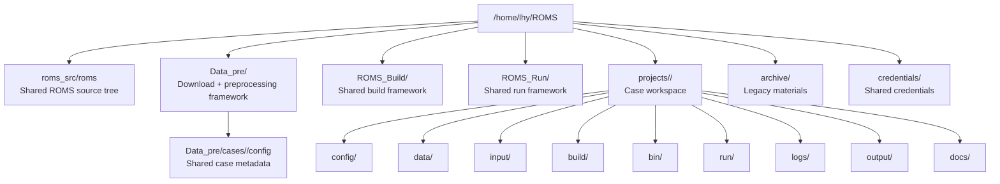
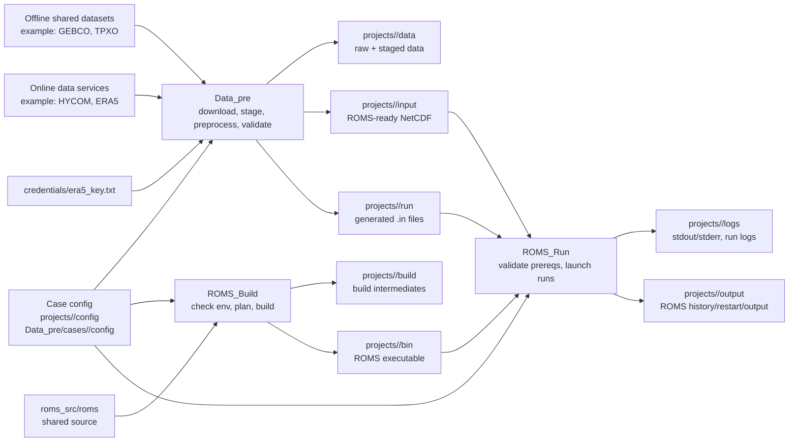

# ROMS Workflow Architecture Overview

This document summarizes the current `/home/lhy/ROMS` architecture and the relationship between preprocessing, build, run, and case workspaces.

## Directory Relationship

## Workflow Relationship

## Responsibility Split

- `Data_pre`: turns external or offline datasets into ROMS-ready inputs.
- `ROMS_Build`: turns shared ROMS source into a case-usable executable.
- `ROMS_Run`: turns executable + `.in` + input files into an actual model run.
- `projects/<case_name>`: stores all case-specific inputs, binaries, logs, and outputs.
- `archive/`: stores legacy projects, tools, and notes that should not stay in the active workflow.
- `credentials/`: stores shared secret files referenced by active workflows.

## Initial-Condition Note

- Scientific initial conditions belong to the ocean preprocessing chain, for example `Data_pre/scripts/ocean/create_ocean_ini_from_hycom.py`.
- `Data_pre/scripts/run_support/create_initial_nc.py` is `technical fallback only`.
- Its output `roms_ini_pilot.nc` exists to support smoke tests and file-plumbing checks before real ocean initial fields are available.
- It should not be interpreted as a scientific substitute for HYCOM- or GLORYS-derived initial conditions.

## End-to-End View

1. Define or update case configuration.
2. Use `Data_pre` to download, subset, preprocess, and validate inputs.
3. Use `ROMS_Build` to compile the ROMS executable for that case.
4. Use `ROMS_Run` to validate the run layout and launch smoke, pilot, or production runs.
5. Keep runtime products inside `projects/<case_name>/`.
