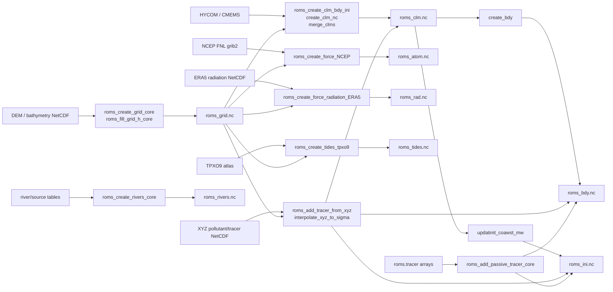

# ROMS 输入文件依赖图

来源快照：`/private/tmp/my_roms_tools`  
核验 commit：`7b94657341d25ea7d975093c71780b267a36a6f4`  
核验日期：2026-06-24

## 总览



## ROMS `*.in` 文件关系

| 前处理输出 | ROMS 输入字段 | 说明 |
| --- | --- | --- |
| `roms_grid.nc` | `GRDNAME` | 网格、地形、mask |
| `roms_ini.nc` | `ININAME` | 初始场 |
| `roms_bdy.nc` | `BRYNAME` | 开边界 |
| `roms_clm.nc` | `CLMNAME` | 气候态 |
| `roms_nud.nc` | `NUDNAME` | nudging 系数，若生成 |
| `roms_atom.nc` | `FRCNAME` | 大气 bulk forcing |
| `roms_rad.nc` | `FRCNAME` | 辐射 forcing |
| `roms_tides.nc` | `TIDENAME` | 潮汐 forcing |
| `roms_rivers.nc` | `SSFNAME` 或 source/river 相关字段 | 河流、点源和示踪剂输入 |
| `varinfo.yaml` | `VARNAME` | 变量元信息 |

## 数据类别与变量归属

| 数据类别 | 外部资料 | 进入 ROMS 的变量 | 生成文件 | 备注 |
| --- | --- | --- | --- | --- |
| 地形/岸线 | GEBCO/ETOPO/本地 DEM | `h`, `mask_rho`, `pm`, `pn`, `angle` | `roms_grid.nc` | 优先级最高，决定海陆和水深 |
| 海洋初始场 | HYCOM/CMEMS 等 | `zeta`, `u`, `v`, `ubar`, `vbar`, `temp`, `salt` | `roms_ini.nc` | 模拟起始时刻三维状态 |
| 海洋边界场 | HYCOM/CMEMS 等 | `zeta_*`, `u_*`, `v_*`, `ubar_*`, `vbar_*`, `temp_*`, `salt_*` | `roms_bdy.nc` | 开边界时间序列 |
| 海洋气候态/外部水文场 | HYCOM/CMEMS 等 | `zeta`, `u`, `v`, `ubar`, `vbar`, `temp`, `salt` | `roms_clm.nc` | 是否使用取决于 CPP 和 `.in` 配置 |
| 大气强迫 | ERA5/NCEP 等 | `Uwind`, `Vwind`, `Pair`, `Tair`, `Qair`, `rain` | `roms_atom.nc` | 风向需转换为东西/南北分量 |
| 辐射/热通量 | ERA5/NCEP 等 | `swrad`, `lwrad`, `lwrad_down` | `roms_rad.nc` | 与 bulk flux/热通量选项配套 |
| 表面淡水通量 | ERA5/NCEP/派生计算 | `rain`, `EminusP` | forcing NetCDF | 影响盐度，不能与降水重复计算 |
| 潮汐 | TPXO9 等 | `tide_Eamp`, `tide_Ephase`, `tide_Cmax`, `tide_Cmin`, `tide_Cangle`, `tide_Cphase` | `roms_tides.nc` | 海面潮位和潮流分潮 |
| 点源/排口 | 监测/设计/假设情景 | `river_transport`, `river_dye_01`, `river_temp`, `river_salt` | `roms_rivers.nc` | 22 TBq/year 需转换为 Bq/s 和浓度 |

## 生成顺序

1. 网格和地形：`roms_grid.nc`
2. 水文初边界：`roms_clm.nc`, `roms_bdy.nc`, `roms_ini.nc`
3. 大气强迫：`roms_atom.nc`
4. 辐射强迫：`roms_rad.nc`
5. 潮汐强迫：`roms_tides.nc`
6. 河流/点源：`roms_rivers.nc`
7. 示踪剂补充：按需要写入 `ini/bdy/clm/rivers`
8. ROMS 输入文件：把所有文件路径写入 `*.in`
9. 编译 CPP 头文件：确保打开相应动力、温盐、潮汐、河流、示踪剂输出选项

## 最小真实 project 文件包

正式 project 至少应归档：

```text
project_name/
├── configs_project.m
├── preprocessing/
│   ├── make_grid.m
│   ├── make_clm_bdy_ini.m
│   ├── make_forcing.m
│   ├── make_tides.m
│   ├── make_rivers_sources.m
│   └── add_tracers.m
├── input/
│   ├── roms_grid.nc
│   ├── roms_clm.nc
│   ├── roms_bdy.nc
│   ├── roms_ini.nc
│   ├── roms_atom.nc
│   ├── roms_rad.nc
│   ├── roms_tides.nc
│   └── roms_rivers.nc
├── run/
│   ├── project.h
│   ├── ocean_project.in
│   ├── build_roms.sh
│   └── run_roms.sh
└── docs/
    ├── data_provenance.md
    └── method_notes.md
```

## 模块到论文方法的映射

| 模块 | 论文应交代 |
| --- | --- |
| 网格/地形 | 研究区范围、水平分辨率、垂向层、DEM 来源、mask 修正、最小水深 |
| 初边界/气候态 | 外部海洋资料来源、变量、时间分辨率、插值、边界条件 |
| 大气强迫 | 风、气压、气温、湿度、降水、辐射来源和处理 |
| 潮汐 | 潮汐产品、分潮列表、时间基准 |
| 河流/点源 | 位置、方向、流量、温盐、浓度、垂向分配 |
| 示踪剂/污染物 | 形态、单位、初始/边界/源项、衰变或相互作用假设 |
| 运行配置 | ROMS 版本、CPP 选项、时间步长、输出频率、并行划分 |
| 验证 | 观测数据、指标、时间空间匹配方法 |

## 验收清单

- [ ] 每个输入 NetCDF 能被 `ncinfo` 或 `ncdump -h` 读取。
- [ ] 所有输入文件时间轴覆盖模拟起止时间。
- [ ] 所有变量单位与 ROMS 期望一致。
- [ ] `*.in` 文件路径与实际文件一致。
- [ ] CPP 选项与输入文件匹配：潮汐、河流、示踪剂、诊断输出都已打开。
- [ ] 输出历史文件全局属性能追踪 `git_rev`, `CPP_options`, `script_file`。
- [ ] 所有数据源、处理脚本和参数写入 `docs/data_provenance.md`。

## 当前未锁定事项

正式 project 仍需确定：

- 研究区和分辨率。
- 模拟年份和 spin-up。
- HYCOM/CMEMS/ERA5/NCEP/TPXO9 的具体版本。
- 氚或污染物源项清单。
- 是否考虑衰变、沉降、相态转换。
- 验证数据来源。
